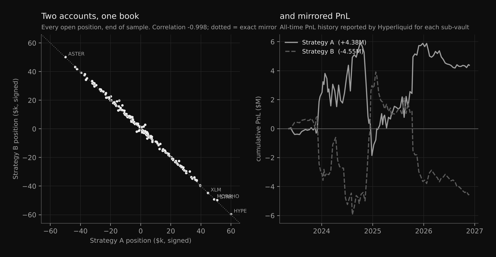
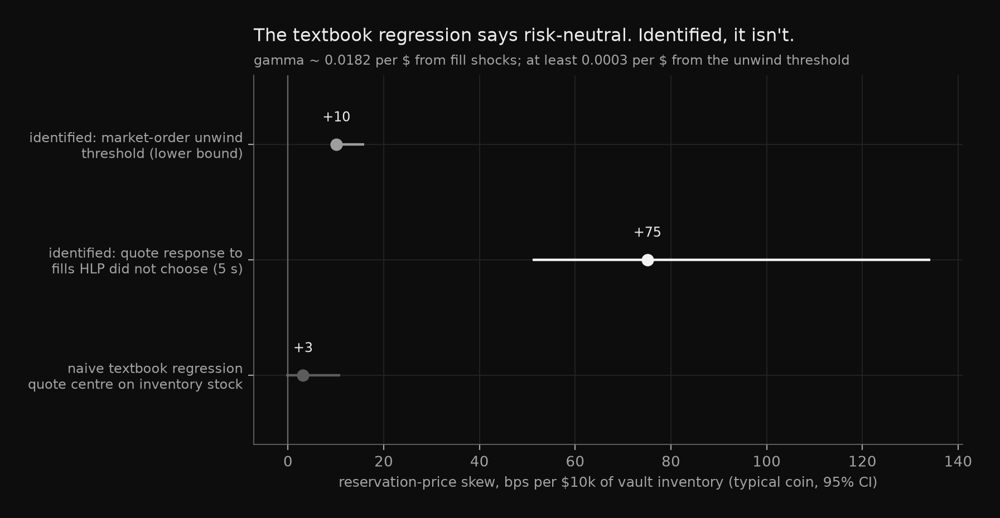
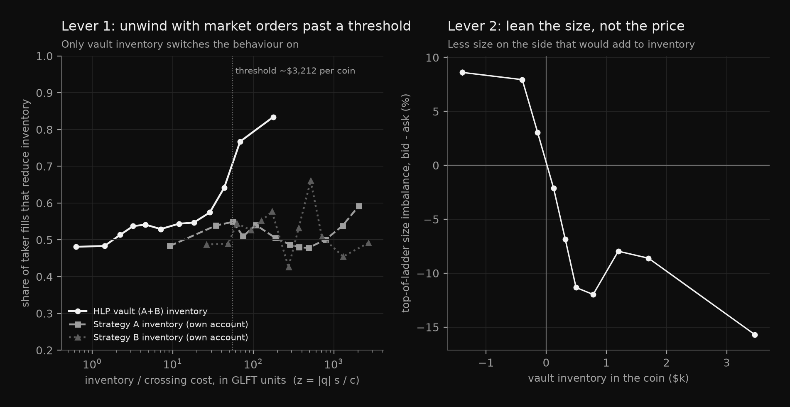
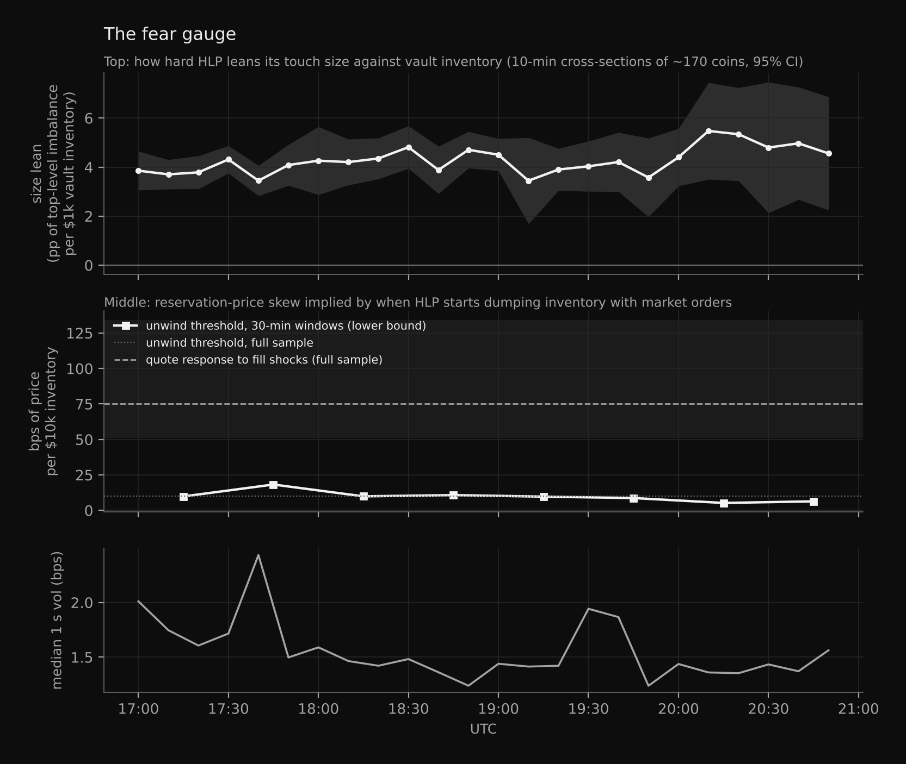

# Market Maker Fear Gauge

Recovering the risk aversion of Hyperliquid's protocol market maker, HLP, from its public quotes, fills and inventory, and finding where the textbook market-making model (Avellaneda–Stoikov, Guéant–Lehalle–Fernandez-Tapia) breaks.



**Data.** 3.9 hours of live Hyperliquid data (17:06–20:59 UTC, 23 November 2026), collected by two GitHub Actions runners from the public API: 3,481,914 snapshots of HLP's quote ladders on 174 coins, 38,820 HLP fills, 529,457 public trades, the 1 Hz oracle/mark/mid stream and 10-second inventory snapshots, plus a backfill of 1-minute candles, funding and vault history.

**Stack.** Python, Hyperliquid API, SciPy (root finding, profile likelihood), statsmodels (HAC / clustered OLS, Poisson GLM, logit), pandas, pyarrow, matplotlib. Collection runs on GitHub Actions; analysis is reproducible from the data branches with one command.

---

## Findings

**1. The market maker is the vault, not an account.** HLP trades through two sub-vaults, *Strategy A* and *Strategy B*, that quote the same 174 coins at nearly the same prices. Their books are mirror images: across the 177 coins both hold, the correlation of their signed positions is **-0.998** and they agree in sign on 5% of them. Each carries about **$2.8M** of gross exposure; netted coin by coin, the vault carries **$158k**. They trade the same flow (dollar-flow correlation 0.76 per coin-minute), execute together (when both take liquidity on a coin within 250 ms, 88% are on the same side), never trade with each other (0 prints), and their reported all-time PnLs mirror each other: **+$4.38M** and **-$4.55M**. Each account reprices after its sibling's passive fills about as much as after its own (Strategy A: 698 vs 580 bps per $10k filled, t 2.1 and 2.0; Strategy B: 366 vs 444 bps per $10k filled, t 2.6 and 2.5). Measured against either account's own inventory, HLP shows no unwind threshold and no size lean (findings 4 and 5); measured against the vault's, it shows both. Every estimate below is for the vault.

**2. The textbook regression says HLP is risk-neutral. That regression is biased.** In GLFT the quote centre sits at the reservation price `S − ω·q`, so the slope of the quote centre on inventory reveals ω and hence γ. Run coin by coin, that regression gives a median slope of **+3.1 bps per $10k** of vault inventory (95% CI -0.4 to 10.9): statistically indistinguishable from zero, and a small fraction of what the identified estimators below find. The problem is that inventory is not exogenous. Where HLP's quotes lean, it gets filled and inventory piles up, which pushes the levels relationship towards zero.

**3. Identified from inventory shocks HLP did not choose, it leans.** A passive fill changes HLP's inventory through someone else's decision. Five seconds after one, the vault's quote centre has moved against the new inventory in **82%** of coins; the median coin's response is a reservation-price skew of **75 bps per $10k** (95% CI 51 to 134), which inverts to **γ ≈ 0.0182 per $** (CI 0.0084 to 0.0580). In plain terms: HLP prices inventory as if holding $10k of a typical coin for an hour cost it **96 bps (CI 45 to 308 bps)**. The response keeps building for about fifteen minutes and then holds (figure 10); GLFT re-centres instantly.

**4. A second, independent identification from market orders.** The textbook market maker never crosses the spread. HLP does: 76% of its fills are aggressive. In GLFT with market orders, the market maker crosses when its reservation-price deviation `ω·q` exceeds the cost of crossing. HLP behaves like that, and only at vault level: while vault inventory in a coin is small, about half of its taker fills reduce it, as you would expect if they were driven by something else; as inventory grows the share ramps up to 0.83. A step fitted by profile likelihood puts the switch at about **$3,212** of vault inventory per coin, with the share going from **0.54 to 0.81** (likelihood ratio 801 against no switch). Using its measured crossing cost of 4.6 bps, the threshold implies a reservation skew of at least **10 bps per $10k** and **γ ≥ 0.0003 per $** (CI 0.0003 to 0.0008). It is a lower bound, because waiting for a passive fill has option value; it sits below the fill-shock estimate, as it should, and it is a loose one. Fitting the same threshold on either account's own inventory finds nothing (LR 29 and 21).



**5. HLP also leans size, which GLFT has no room for.** GLFT keeps quote size fixed and moves prices. HLP moves size too: its top-of-ladder size imbalance swings from +9% when the vault is short to -16% when it is long, -6.1 pp per $1k of vault inventory within coin (t -11.2) and -3.5 pp across coins (t -8.3). Regressing A's size imbalance jointly on A's own inventory and the vault's: vault **t = -9.7**, own **t = 1.0**. The risk manager sits above the accounts.



**6. The fear gauge.** Two series track HLP's appetite for inventory through the session: how hard it leans touch size against vault inventory (10-minute cross-sections of ~170 coins) and the reservation skew implied by its unwind threshold (30-minute windows). Over this session the size lean held between 3.4 and 5.5 percentage points of imbalance per $1k (coefficient of variation 13%), and the unwind-implied skew between 5 and 18 bps per $10k across 8 half-hour windows. Across the 24 ten-minute windows the size lean was weaker when the market was more volatile (correlation -0.44); with this few windows that is a description of the session, not an estimate of how HLP responds to volatility.



**7. Where else the textbook breaks.**

| Textbook assumption | What HLP does | Evidence |
|---|---|---|
| One agent, one book | Two mirrored sub-vaults; risk is managed on the net | position correlation -0.998; size lean and unwinds load only on vault inventory |
| Inventory managed by price skew | Price skew is only part of it; size lean and market-order unwinds carry the rest | figures 02, 03 |
| Only limit orders | 76% of fills are taker; 70% of taker volume reduces vault inventory | `results/RESULTS.md` |
| Quotes re-centre instantly (Markov in q) | Price response builds for minutes after a shock | figure 10 |
| Fills carry no information | Passive fills start 17 bps in the money and are worth 0.2 bps a minute later | figure 05 |
| Spread = 1/k + (Δ/2)·skew | Quoted half spread is 2.0x the GLFT value in the median coin; 24% of coins quote tighter than any γ allows | figure 04 |
| Monopolist: gets all flow reaching its price | Fills 24% of it (median coin) | figure 06 |
| Spread insensitive to vol when skew is small | Elasticity of the half spread to local vol 0.36 (s.e. 0.06) | `results/RESULTS.md` |
| One quote per side | Eight levels, geometric spacing (10, 20, 37, 66, 119, 172, 248, 360 bps from mid), ~$189 at the touch, $687–1,088 behind | figure 08 |
| Exponential fill curve | Holds up: exponential beats a power law in 73% of coins (median R² 0.93 vs 0.87) | figure 06 |

---

## What HLP is

HLP is Hyperliquid's protocol vault: about **$150M** of depositor capital, of which $6.2M sits in the two trading sub-vaults studied here. They rest roughly 2,900 orders each across 174 perpetuals, cancel and replace about 1,250 orders a second, live a median of 1.7 s per order, and post with `Alo` (post-only) for quotes and IOC for aggressive orders. Liquidator sub-vaults are separate and were excluded.

## How the data was collected

Hyperliquid's API is public, but the order-update stream is only pushed to the account that owns it, so HLP's quotes have to be reconstructed by polling its open orders. That costs 20 of the 1,200 weight a minute each IP gets, so each strategy has its own runner, polling every 1.4 s (`collector/collect.py`, `.github/workflows/collect.yml`). Each runner also streams order books, trades, asset contexts (oracle, mark, mid, funding, open interest), the strategy's fills and `allMids` over websockets, snapshots positions every 10 s and historical orders every 2 minutes, and pushes zstd-compressed parquet to its own `data-*` branch every 10 minutes. A third job backfills candles, funding, recent fills and vault history (`collector/backfill.py`). Over the run the two collectors logged 0 rate-limit errors and 10 websocket reconnects, each recovered automatically within seconds.

## Method

### The model

Guéant, Lehalle and Fernandez-Tapia (2013), in the order-size form of Guéant (2017). The market maker has CARA utility with absolute risk aversion γ (1/$), the mid follows dS = σ dW, and a quote at distance δ from the mid is filled, one lot of size Δ at a time, with intensity Λ(δ) = A e^(−kδ). The closed-form quotes are

```
δ_bid(q) = (1/γΔ) ln(1 + γΔ/k) + (2q + Δ)/2 · ω
δ_ask(q) = (1/γΔ) ln(1 + γΔ/k) − (2q − Δ)/2 · ω
ω        = sqrt( γσ² / (2AkΔ) · (1 + γΔ/k)^(1 + k/γΔ) )
```

Two observable consequences, one unknown:

* **skew**: the quote centre is `S − ω·q`, so the slope of the centre on inventory is ω, which is monotone in γ and inverted with `scipy.optimize.brentq` (`analysis/glft.py`);
* **spread**: the half spread is `(1/γΔ) ln(1 + γΔ/k) + (Δ/2)·ω`. With γΔ/k ≪ 1, as it is here, this is `1/k + (Δ/2)·ω` whatever γ is. That is an over-identifying restriction: half spread, fill-curve slope and skew must line up.

### Calibration

* **σ²**: variance of 10-second mid changes from the 1 Hz asset-context stream.
* **k**: slope of the reach curve of aggressive orders. Public trades are collapsed into aggressive orders (same coin, time, taker), each order's deepest price is measured against the mid just before it, and `log Λ(δ) = log A − kδ` is fitted on the empirical curve (`analysis/estimators.py`). A power law is fitted on the same grid for comparison.
* **A**: the level of the fill curve **HLP itself faces**. For every poll interval and side, HLP's passive fills are Poisson with mean `dt · A · exp(−k δ)`, with δ HLP's own distance from the mid; with k fixed from the market curve, the MLE is `A = N / Σ dt·exp(−kδ)`. Calibrating A on market-wide flow instead assumes the market maker is a monopolist that receives every order reaching its price; the simulation shows what that does to γ.
* **Δ**: median size of HLP's top-of-ladder orders.

### Three ways to identify the skew

1. **Within coin.** Regress HLP's quote-centre offset on its inventory over time, coin by coin, controlling for the oracle–mid basis, top-of-book imbalance and 10 s / 60 s momentum, with Newey–West errors. Needs inventory to actually move.
2. **Fill events.** A passive fill changes HLP's inventory through someone else's decision. Compare the quote centre in the last snapshot before each passive fill with the first snapshot five seconds after, controlling for the change in basis and the mid return. This is the cleanest design and the headline estimator.
3. **Between coins.** At any moment HLP carries some 170 positions of very different size. One cross-sectional regression per 10-minute window of the window-mean quote centre on model-scaled inventory, `x_i = q_i · sqrt(σ_i² e / (2 A_i k_i Δ_i))`, gives θ_w = sqrt(γ_w) directly. That series is the **fear gauge**.

Coin-level slopes are pooled into one γ by inverse-variance weighting of `θ_i = b_i / s_i`, where s_i is the coin's GLFT scale; GLFT says θ is common to every coin.

### Who is the market maker?

HLP trades through two sub-vaults, Strategy A and Strategy B, which quote the same 174 coins at near-identical prices. Their positions are mirror images (see the first figure). Every estimator is therefore run three times: on A, on B, and on **the vault**, V = A + B, with inventory netted coin by coin, fills pooled and equity summed. A further test regresses A's quote centre jointly on A's own inventory and on the vault's net inventory: a vault-level risk manager loads on the second, an account-level one on the first. A cross-account event study asks whether A reprices when B is filled.

### Validation

`analysis/simulate.py` simulates a GLFT market maker with known γ for four hours, observes it the way HLP is observed (1.4 s polls, its own fills, public trades), and runs the same estimators. With k from the market reach curve and A from the market maker's own fills, γ is recovered within a few per cent across three orders of magnitude, whether the simulated market maker receives all of the flow at its price or only 30 % of it. Calibrating A on market flow instead overstates γ by the inverse of the flow share. The spread restriction holds to within ±5 % in simulation, so deviations in the real data are not estimator artefacts.

## Reproduce

```bash
pip install -r requirements.txt
bash analysis/sync_data.sh          # pulls every data-* branch into ./data
python analysis/simulate.py         # ground-truth check of the estimators
python analysis/run_all.py          # panel -> estimates -> tests -> results/
python analysis/figures.py          # figures/
python analysis/report.py           # results/RESULTS.md
```

The `analyze` workflow runs the same five steps on GitHub Actions with pinned versions; the committed `results/` and `figures/` are its output. A rerun on the same machine reproduces every number exactly; on a different CPU, results agree to three or four significant figures, because tied timestamps can sort differently before sub-sampling. To collect a new sample, run the `collect` workflow (default 340 minutes).

## Layout

```
collector/collect.py     live collector: quote ladders, books, trades, fills, contexts, inventory
collector/backfill.py    candles, funding, recent fills, vault history
analysis/glft.py         GLFT closed form, inversion for gamma (brentq)
analysis/estimators.py   volatility, fill-curve fit, HAC skew regression
analysis/panel.py        loads the data; builds the per-(coin, snapshot) panel; the vault as one agent
analysis/model.py        calibration, three skew estimators, fill-event profile, size lean, unwind threshold, gauge
analysis/breaks.py       tests of each textbook assumption, mirror statistics, inventory attribution
analysis/simulate.py     simulated GLFT market maker with known gamma
analysis/run_all.py      the pipeline
results/                 summary.json, RESULTS.md, per-coin parameters, every table behind a figure
figures/                 the figures above
```

## Limitations

* The analysis window is fixed at 17:06–20:59 UTC in `analysis/config.py`; the collector ran past it. 3.9 hours on one day is a sample of HLP's behaviour, not its policy. The fear gauge has 24 windows; it shows what the gauge measures rather than a long history.
* Quotes are snapshots every 1.4 s of a book that changes every ~1.7 s, so the fastest repricing is not observed.
* The fill-event estimate uses the median coin; a pooled regression is dominated by a handful of coins with very large scaled inventory changes and is reported but not headlined. Responses at long horizons mix in later fills and unwinds.
* The unwind threshold is a lower bound on γ under GLFT with market orders; mapping it exactly would need the full quasi-variational inequality solved per coin.
* Positions of A and B are mirrored, but I have no way to see why; concealing the vault's net position is one hypothesis, not a finding.

---

*Independent research. Not affiliated with Hyperliquid. Nothing here is investment advice.*
